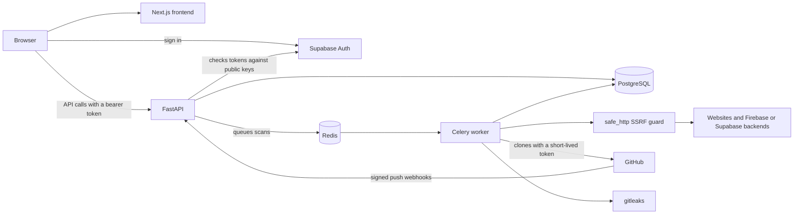

# GapScan

Security checks for websites and GitHub repositories, built for students, freelancers and small agencies. GapScan finds the gaps that matter on apps shipped with Firebase, Supabase, Vercel or Netlify, and explains each fix in plain language.

GapScan is open source and self-hostable. Run it yourself by following [docs/SELF_HOSTING.md](docs/SELF_HOSTING.md).

> **Scan only what you own or have written permission to test.** See [SECURITY.md](SECURITY.md).

## Screenshots

> _Screenshot placeholder: a scan report with its grade._

> _Screenshot placeholder: a combined finding across a repository and a website._

> _Screenshot placeholder: the dashboard._

## Features

**Website scan**
- A quick scan works on any domain and is passive only: TLS and certificates, security headers, cookies, DNS and email records (SPF, DMARC, CAA), and WordPress version detection.
- A full scan needs a verified domain and adds active checks: exposed `.env` and `.git` files, backups, source maps and directory listings.
- Each finding explains what it means and how to fix it, with snippets for Vercel, Netlify, nginx and Cloudflare where they apply.

**Repository secret scanning**
- A GitHub App and [gitleaks](https://github.com/gitleaks/gitleaks) check a repository's whole git history.
- Each push then scans only its new commits.
- Findings are masked and come with steps for replacing each kind of key.

**Firebase and Supabase checks**
- Finds the backends named in a site's own code, and flags a server-only Supabase key in a script as critical.
- With the owner's confirmation, read-only probes check for a readable Firebase Realtime Database, a listable Storage bucket, and readable Supabase tables.
- A table can be marked as meant to be public, so it stops affecting the grade.

**Combined findings**
- When a key leaked in your repository belongs to a backend your site uses, the two become one finding, with steps to replace the key and clean up git history.
- Matching stays inside one owner's repositories and verified domains, and compares project identifiers only.
- Owners can mark a key as rotated, and reopen it if that was a mistake.

**Grades**

Scores start at 100. Each finding deducts points: critical 25, high 15, medium 7, low 2, info 0.

| Grade | Score |
|---|---|
| A+ | 95 and up |
| A | 85 to 94 |
| B | 70 to 84 |
| C | 55 to 69 |
| D | 40 to 54 |
| F | below 40 |

No HTTPS, or an expired or untrusted certificate, caps the grade at F. Any other critical finding caps it at D. A confirmed admin key leaked in a linked repository costs 25 points once per project and caps the grade at D.

## Tech stack

| Layer | Choice |
|---|---|
| Frontend | Next.js (App Router), TypeScript, Tailwind CSS, shadcn/ui, TanStack Query |
| API | FastAPI, Pydantic, SQLModel, Alembic |
| Jobs | Celery and Redis |
| Database | PostgreSQL |
| Sign-in | Supabase Auth (GitHub and magic link), verified by the API |
| Repository scanning | GitHub App, webhooks, gitleaks |

## Architecture



## Security design

GapScan points outbound requests at addresses supplied by its users, so it treats its own scanner as a risk.

- **SSRF guard.** Every outbound HTTP request goes through `backend/app/core/safe_http.py`. It resolves DNS itself, blocks private, loopback, link-local, reserved and multicast addresses on IPv4 and IPv6, checks again after every redirect, and caps redirects, time and response size. The one exception is the repository `git clone`, which only ever targets `https://github.com/<owner>/<name>.git`, with redirects off and the name taken from a GitHub API response.
- **Domain verification.** Active checks and backend probes run only on domains whose owner proved control with a DNS TXT record or a file. Ownership is proven again before every full scan. Quick scans stay passive.
- **Polite scanner.** Scans identify themselves with an honest User-Agent, send at most about two requests a second to any host, pause randomly between active checks, and stop requesting a site at its first bot-protection challenge.
- **Read-only probes.** Backend probes read and never write. Nothing is sent to a backend until the domain's owner confirms it's theirs, and results keep only yes or no answers, counts and table names, never rows.
- **Secrets never stored.** gitleaks runs with `--redact`, and only a masked form with a fixed prefix such as `AKIA****` is saved. No characters of a real key are kept, so keys are never compared either.
- **Access and input.** Every record is owner-only, and other people's IDs answer 404. All input is validated with Pydantic, GitHub webhook signatures are verified, CORS is an explicit allowlist, and API routes are rate limited.

### About GapScanBot, for site owners

If you found `GapScanBot` in your logs, someone ran GapScan against your site. Unless they proved they control your domain, the scan was passive: the requests look like an ordinary visit. Each deployment is run by whoever installed it, and they can set the User-Agent to link to their own page. To stop a deployment, block its User-Agent or IP address. If you think GapScan itself is being misused, please [open an issue](https://github.com/VivekSharma0502/gapscan/issues).

## Quick start

This runs quick scans on your machine with no accounts. You need Python 3.11+, Node.js 22+ and Docker. For sign-in, full scans and repository scanning, follow [docs/SELF_HOSTING.md](docs/SELF_HOSTING.md).

Windows PowerShell, from the repo root:

```powershell
git clone https://github.com/VivekSharma0502/gapscan.git
cd gapscan
Copy-Item .env.example .env
docker compose up -d redis postgres
python -m venv backend/.venv
backend/.venv/Scripts/python.exe -m pip install -r backend/requirements.txt
npm --prefix frontend install
cd backend
.venv/Scripts/python.exe -m alembic upgrade head
```

macOS or Linux: use `cp` to copy the file, and `backend/.venv/bin/python` in place of the Windows path.

Then run each of these in its own terminal:

```powershell
# API on http://localhost:8000, from backend/
.venv/Scripts/python.exe -m uvicorn app.main:app --reload --port 8000

# Worker, from backend/. --pool=solo is needed on Windows.
.venv/Scripts/python.exe -m celery -A app.workers.celery_app worker --pool=solo --loglevel=info -Q celery,repo_scans

# Web app on http://localhost:3000, from frontend/
npm run dev
```

Open <http://localhost:3000> and enter a domain you own.

## Project docs

- [docs/SELF_HOSTING.md](docs/SELF_HOSTING.md): full setup and troubleshooting
- [CONTRIBUTING.md](CONTRIBUTING.md): how to contribute, tests and lint
- [SECURITY.md](SECURITY.md): reporting vulnerabilities and responsible use
- [PLAN.md](PLAN.md): scope and roadmap
- [CHANGELOG.md](CHANGELOG.md): history

The product name is set once, in `product.json`. The backend and frontend both read it.

## License

GapScan is licensed under the [GNU Affero General Public License v3.0](LICENSE). If you run a modified version as a network service, the AGPL requires you to offer its users the source code of your version.
